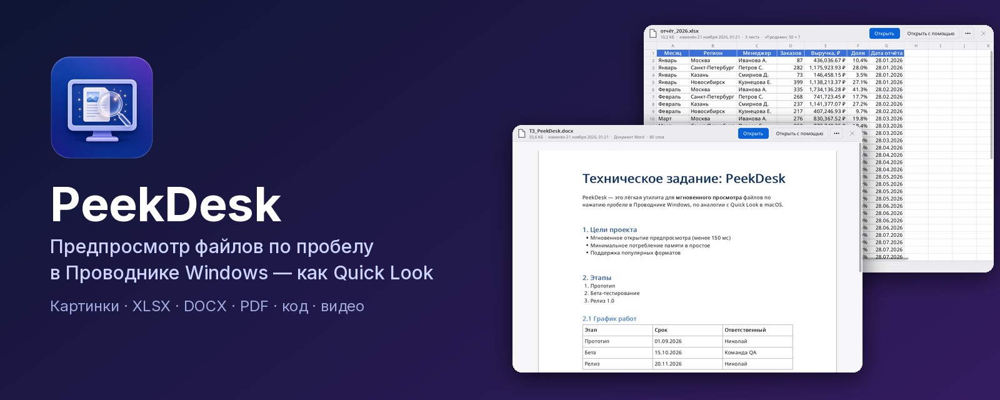
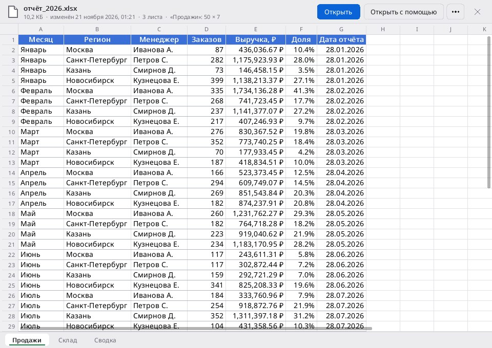
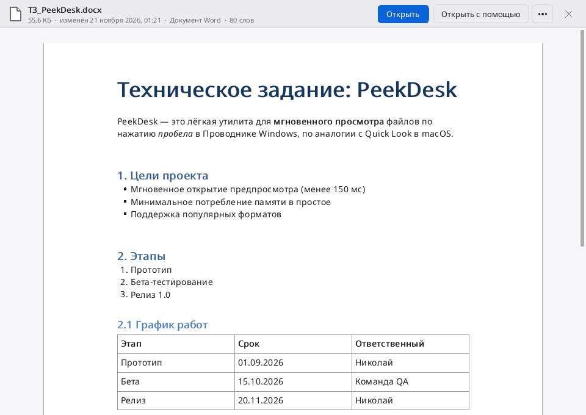
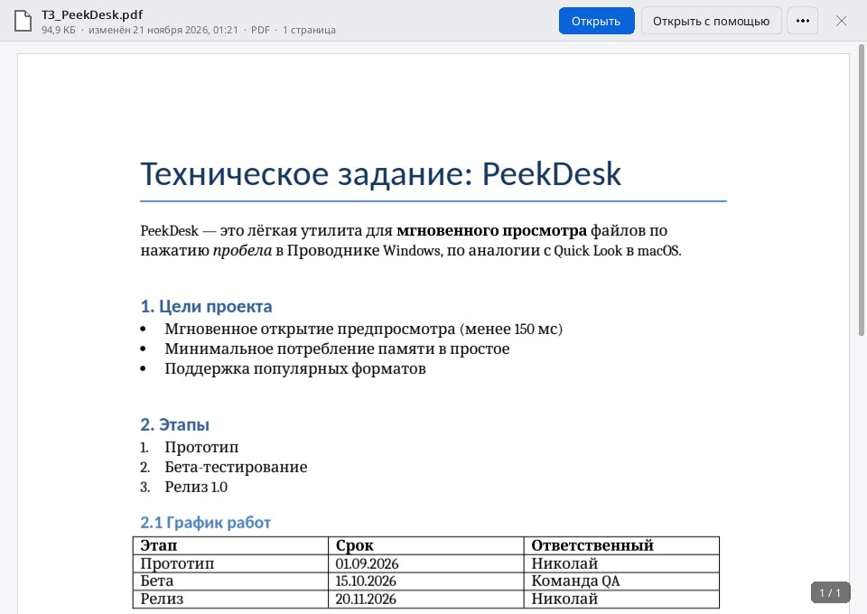
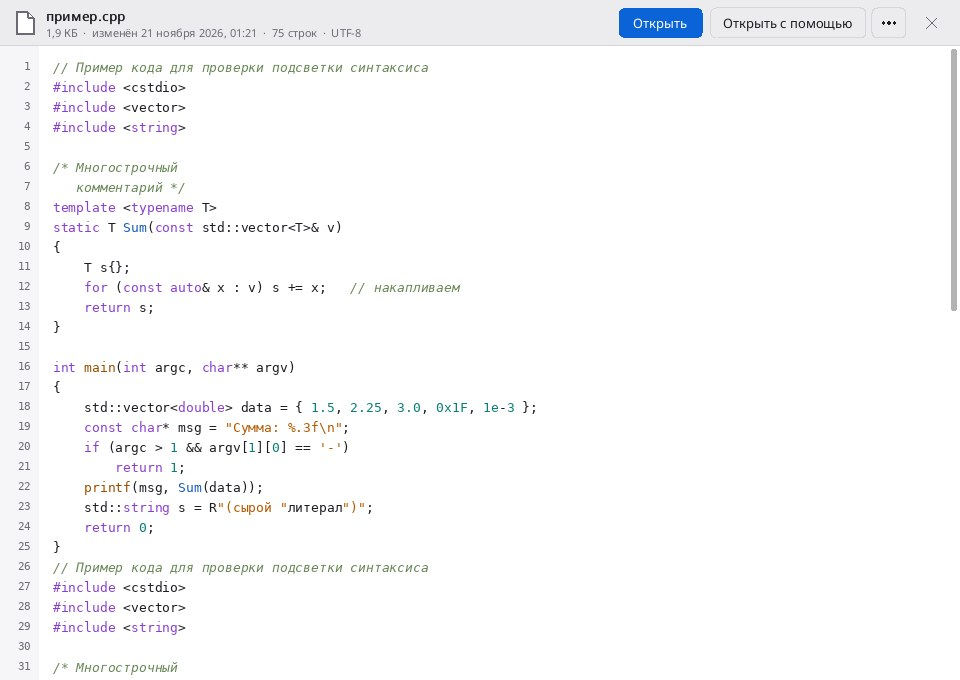
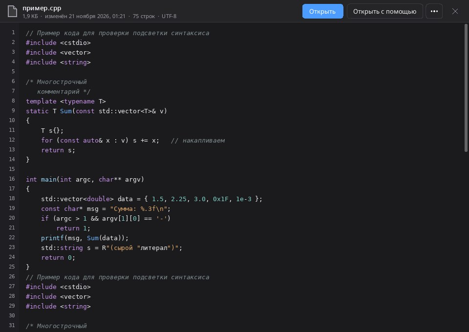
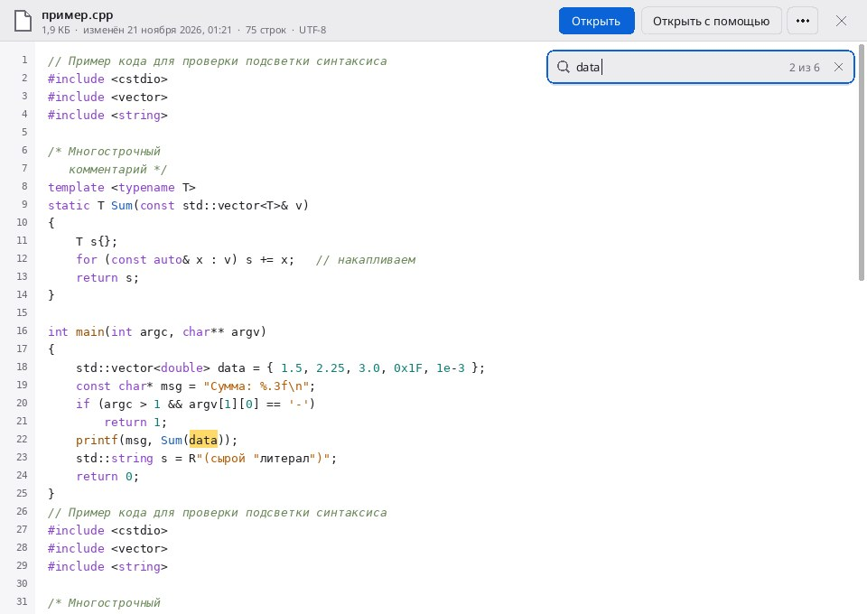
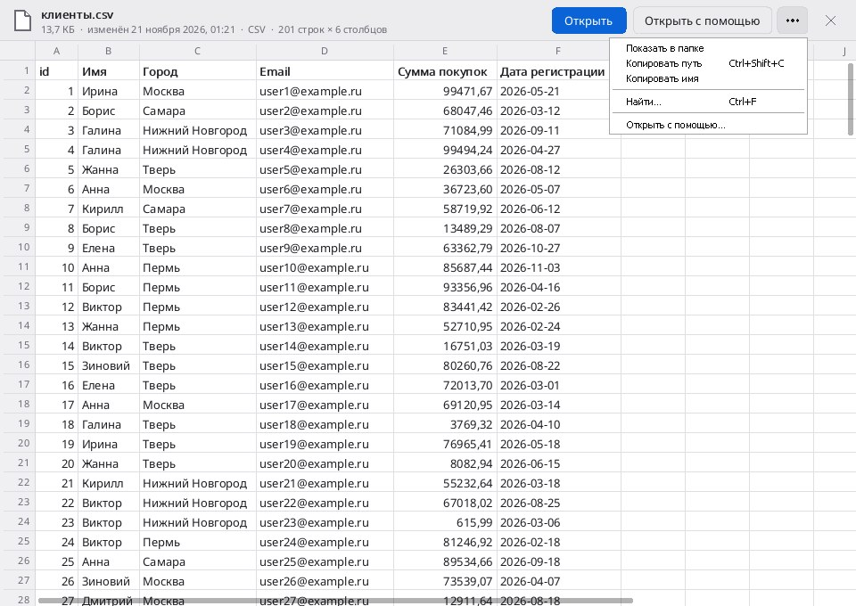
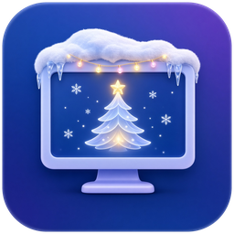

  

  
   Скачивается сразу ZIP с последней версией · <a href="https://github.com/NikoliniOFF/PeekDesk/releases">Все версии</a>

  
  
  

<h1 align="center">PeekDesk для Windows</h1>

  <b>Выделите файл в Проводнике и нажмите пробел — он откроется в окне предпросмотра.</b> 
  Ещё раз пробел или <kbd>Esc</kbd> — окно закрылось. Как Quick Look в macOS, только для Windows 10 и 11. 
  Бесплатно · без установки · без рекламы · обновляется сама.

---

## ✨ Что умеет

| | |
|---|---|
| ⚡ **Мгновенно** | Окно появляется за доли секунды, большие файлы дочитываются в фоне. В трее PeekDesk почти не тратит память и процессор — ничего не опрашивает, пока вы не нажали пробел. |
| 🖼️ **Картинки** | PNG, JPEG, GIF с анимацией, BMP, TIFF, ICO, WebP, Photoshop (PSD) и HEIC с iPhone (через кодек Windows). Масштаб колесом мыши, поворот с сохранением, обрезка и пипетка цвета. |
| 📊 **Таблицы** | Excel (XLSX) с листами — переключаются щелчком по ярлычку, — форматами чисел, заливками и объединёнными ячейками, а ещё CSV и TSV — без установленного Excel. Огромные файлы листаются без задержек. |
| 📄 **Документы** | Word (DOCX) — заголовки, списки, таблицы и картинки. PowerPoint (PPTX) — слайды с текстом, картинками и таблицами. PDF — встроенным движком PDFium, со счётчиком страниц. |
| 💻 **Текст и код** | Подсветка синтаксиса и номера строк, кодировка (UTF-8, UTF-16, Windows-1251) определяется сама. Markdown — красивым документом или исходником одной кнопкой. |
| 🎬 **Аудио и видео** | MP3, WAV, FLAC, MP4, MOV, MKV и другие — с перемоткой, скоростью 0,5×–2× и громкостью, которая запоминается. Несколько звуковых дорожек переключаются прямо в окне. **Обрезка видео без перекодирования** (все дорожки сохраняются) и снимок кадра в PNG. |
| 📁 **Папки и архивы** | Папка — сеткой миниатюр, с размером и числом файлов. ZIP, RAR и 7z — папки внутри, просмотр файла прямо из архива и «Извлечь всё», без WinRAR и 7-Zip. Для остальных типов — системные обработчики просмотра. |
| 🗂️ **Несколько файлов** | Выделили несколько и нажали пробел — внизу лента миниатюр, стрелки листают. Панель «Сведения» (<kbd>Ctrl</kbd>+<kbd>I</kbd>): даты, EXIF, кодеки видео. «Открыть с помощью» со списком программ, файл можно перетащить из окна в чат или письмо. |
| 🔎 **Поиск и копирование** | <kbd>Ctrl</kbd>+<kbd>F</kbd> в тексте, документах, PDF и таблицах. Выделите текст или диапазон ячеек мышью и нажмите <kbd>Ctrl</kbd>+<kbd>C</kbd>. |
| 🌗 **Светлая и тёмная тема** | Следует теме Windows или выбирается вручную. Окно запоминает размер — отдельно для картинок, таблиц, документов и видео. |

## 📸 Как это выглядит

 

 

 

## 📥 Как установить

1. Скачайте **[PeekDesk-win64.zip](https://github.com/NikoliniOFF/PeekDesk/releases/latest/download/PeekDesk-win64.zip)** (или выберите файл на странице [последней версии](https://github.com/NikoliniOFF/PeekDesk/releases/latest)).
2. Распакуйте архив в постоянную папку, например `Документы\PeekDesk`.
3. Запустите **PeekDesk.exe** — значок появится в трее у часов. Выделите любой файл в Проводнике и нажмите пробел.
4. Если Windows покажет синее окно *«Система Windows защитила ваш компьютер»*, нажмите **«Подробнее» → «Выполнить в любом случае»** (подробнее — в разделе «Вопросы»).

> Устанавливать ничего не нужно: PeekDesk — одна программа. Чтобы удалить, выберите «Выход» в меню значка и удалите папку.

## ⌨️ Клавиши

| Клавиша | Действие |
|---|---|
| <kbd>Пробел</kbd> в Проводнике или на рабочем столе | открыть / закрыть предпросмотр |
| <kbd>Esc</kbd>, <kbd>Ctrl</kbd>+<kbd>W</kbd> | закрыть |
| <kbd>↑</kbd> <kbd>↓</kbd> <kbd>←</kbd> <kbd>→</kbd> в Проводнике | окно показывает следующий выделенный файл |
| <kbd>Enter</kbd>, <kbd>Ctrl</kbd>+<kbd>O</kbd> | открыть файл в его программе (Enter или двойной щелчок в Проводнике тоже открывают файл — окно просмотра закроется само) |
| <kbd>Ctrl</kbd>+<kbd>F</kbd>, <kbd>F3</kbd> / <kbd>Shift</kbd>+<kbd>F3</kbd> | поиск, следующее / предыдущее совпадение |
| <kbd>Ctrl</kbd>+<kbd>C</kbd>, <kbd>Ctrl</kbd>+<kbd>A</kbd> | копировать выделенное, выделить всё |
| <kbd>Ctrl</kbd>+<kbd>Shift</kbd>+<kbd>C</kbd> | копировать путь к файлу |
| колесо мыши, <kbd>0</kbd>, <kbd>1</kbd>, <kbd>R</kbd> | картинка: масштаб, вписать, 100 %, повернуть |
| щелчок по ярлычку, <kbd>Ctrl</kbd>+<kbd>PgUp</kbd> / <kbd>PgDn</kbd> | таблица: другой лист |
| <kbd>K</kbd>, <kbd>←</kbd> <kbd>→</kbd>, <kbd>[</kbd> <kbd>]</kbd> | видео: пауза, перемотка на 5 с, скорость |
| <kbd>↑</kbd> <kbd>↓</kbd>, колесо над панелью, <kbd>M</kbd>, <kbd>A</kbd> | видео: громкость, без звука, следующая звуковая дорожка |
| <kbd>←</kbd> <kbd>→</kbd> при нескольких файлах | следующий / предыдущий файл из выделенных |
| <kbd>Ctrl</kbd>+<kbd>I</kbd> | панель «Сведения» |
| <kbd>Ctrl</kbd>+<kbd>T</kbd>, <kbd>I</kbd> / <kbd>O</kbd>, <kbd>Ctrl</kbd>+<kbd>Shift</kbd>+<kbd>S</kbd> | видео: обрезка, начало / конец куска, снимок кадра |
| <kbd>C</kbd>, <kbd>I</kbd>, <kbd>Ctrl</kbd>+<kbd>S</kbd> | картинка: обрезка, пипетка, сохранить правку |
| <kbd>Backspace</kbd> | назад (из папки или архива) |
| правый клик по заголовку, кнопка «…» | показать в папке, копировать путь и имя, открыть с помощью |

## ⚙️ Настройки

Щёлкните значок PeekDesk в трее (справа внизу, у часов) → **«Настройки»**. Каждый формат и каждая функция включается отдельно: подсветка синтаксиса, номера строк, перенос строк, поиск, выделение, масштаб колесом, размер окна для каждого типа и другое. Там же — тема, автозапуск и обновления.

Настройки хранятся в `%APPDATA%\PeekDesk\settings.ini`.

## 🔄 Как обновлять

PeekDesk сам проверяет новые версии на этой странице: через минуту после запуска и затем раз в 12 часов. В настройках, раздел **«Обновления»**, можно выбрать **«Автоматически»**, **«Спрашивать»** *(по умолчанию)* или **«Не проверять»** (тогда — пункт «Проверить обновления» в меню значка). Каждый выпуск проверяется по размеру и контрольной сумме SHA-256, настройки сохраняются.

## ❓ Вопросы

<b>Windows пишет «Система Windows защитила ваш компьютер»</b>

Это фильтр SmartScreen: программа новая и пока не подписана платным сертификатом. Нажмите **«Подробнее»**, затем **«Выполнить в любом случае»**. Скачивайте PeekDesk только со [страницы выпусков](https://github.com/NikoliniOFF/PeekDesk/releases) — рядом с каждым архивом лежит файл `.sha256` с контрольной суммой.

<b>Пробел перестал работать в Проводнике?</b>

PeekDesk перехватывает пробел, только когда в Проводнике или на рабочем столе выделен файл и не идёт переименование или ввод в строку поиска. В остальных программах пробел работает как обычно. Временно выключить: «Просмотр по пробелу» в настройках или «Выход» в меню значка.

<b>Не будет ли тормозить компьютер?</b>

Нет. В трее PeekDesk ничего не делает и не опрашивает — просыпается только по нажатию пробела. Тяжёлые части (PDF, видео) загружаются при первом открытии такого файла и выгружаются после.

<b>Как открыть файл без Проводника?</b>

`PeekDesk.exe --preview "C:\путь\к\файлу.xlsx"` — или «Открыть с помощью → PeekDesk».

<b>Программа что-нибудь собирает или отправляет?</b>

Нет. Файлы читаются только на вашем компьютере. В интернет PeekDesk обращается лишь к GitHub, чтобы проверить обновления, — это можно выключить.

## 📜 Сторонние компоненты

- **PDFium** — движок PDF (лицензия BSD).
- **LZMA SDK** Игоря Павлова — распаковка 7z (общественное достояние).
- **UnRAR** Александра Рошала — только распаковка RAR. Из лицензии UnRAR: *«UnRAR source code may be used in any software to handle RAR archives without limitations free of charge, but cannot be used to develop RAR (WinRAR) compatible archiver and to re-create RAR compression algorithm, which is proprietary. Distribution of modified UnRAR source code in separate form or as a part of other software is permitted, provided that full text of this paragraph, starting from "UnRAR source code" words, is included in license, or in documentation if license is not available, and in source code comments of resulting package.»*

## 🧩 Другие программы от Nikolini

<table>
  <tr>
    <td width="96" align="center"></td>
    <td>
      <b><a href="https://nikolinioff.github.io/WinterDesk/">WinterDesk</a></b> — снег на рабочем столе Windows: сугробы на окнах, гирлянды, ёлочка и отсчёт до Нового года. 
      <a href="https://nikolinioff.github.io/WinterDesk/">Сайт</a> · <a href="https://github.com/NikoliniOFF/WinterDesk">GitHub</a>
    </td>
  </tr>
  <!-- Новая программа: скопируйте строку <tr>…</tr> выше и поменяйте значок, название, описание и ссылки. -->
</table>

Все программы — на [github.com/NikoliniOFF](https://github.com/NikoliniOFF).

## 💬 Обсуждение

- 💡 [Предложить идею](https://github.com/NikoliniOFF/PeekDesk/discussions/new?category=%D0%B8%D0%B4%D0%B5%D0%B8)
- 🐞 [Сообщить о баге](https://github.com/NikoliniOFF/PeekDesk/issues/new?template=bug.yml)
- 💬 [Все обсуждения](https://github.com/NikoliniOFF/PeekDesk/discussions)

---

PeekDesk · автор — <a href="https://github.com/NikoliniOFF">Nikolini (NikoliniOFF)</a> · бесплатно и без рекламы

